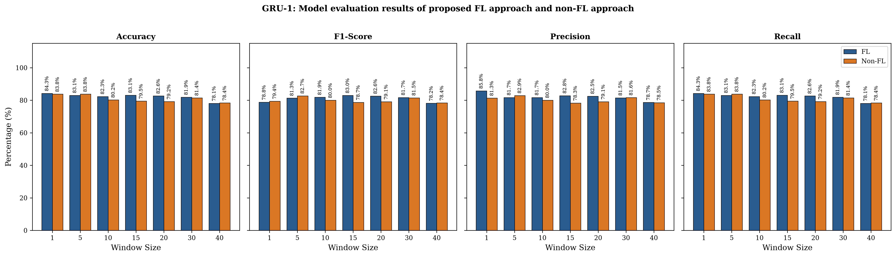
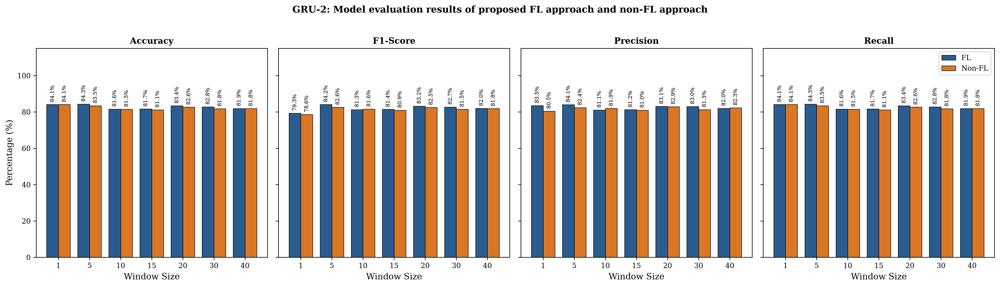
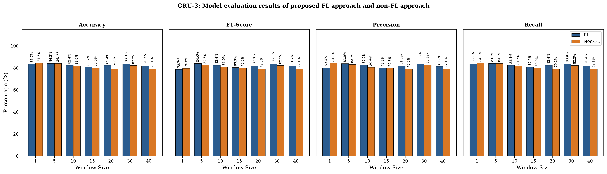
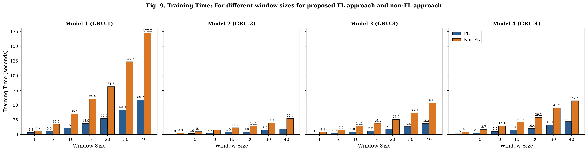
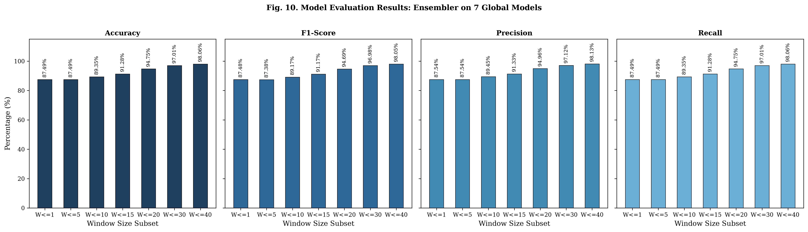
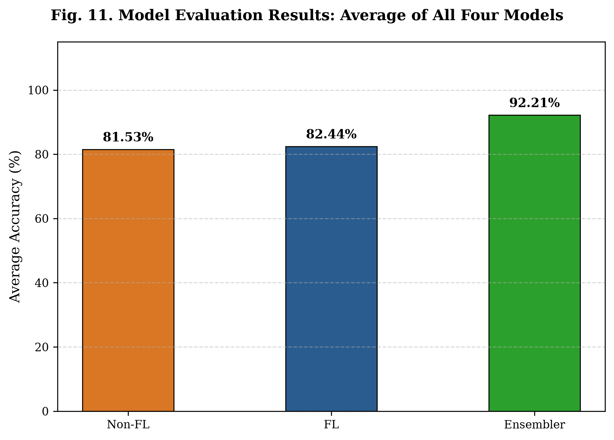

# Federated-Learning-Based Anomaly Detection for IoT Security Attacks

[](https://www.python.org/downloads/)
[](https://pytorch.org/)
[](https://opensource.org/licenses/MIT)
[-00629B.svg)](https://doi.org/10.1109/JIOT.2021.3077803)

This repository provides an end-to-end, empirical replication and open-source implementation of the research paper:

> **Federated-Learning-Based Anomaly Detection for IoT Security Attacks**  
> *Viraaji Mothukuri, Prachi Khare, Reza M. Parizi, Seyedamin Pouriyeh, Ali Dehghantanha, and Gautam Srivastava*  
> **IEEE Internet of Things Journal**, Vol. 9, No. 4, February 15, 2022.  
> **DOI:** [10.1109/JIOT.2021.3077803](https://doi.org/10.1109/JIOT.2021.3077803)

---

## Table of Contents
1. [Overview & Research Motivation](#1-overview--research-motivation)
2. [Architecture & Methodology](#2-architecture--methodology)
3. [Replication Evolution: Multi-Run Benchmark](#3-replication-evolution-multi-run-benchmark)
4. [Dataset & Upstream Bug Fixes](#4-dataset--upstream-bug-fixes)
5. [Replicated IEEE Figures](#5-replicated-ieee-figures)
6. [Complete 28-Configuration Benchmark Matrix](#6-complete-28-configuration-benchmark-matrix)
7. [Repository Structure](#7-repository-structure)
8. [Quickstart & Reproduction Guide](#8-quickstart--reproduction-guide)
   - [Native Python Environment](#option-a-native-python-environment)
   - [Turnkey Docker Container](#option-b-turnkey-docker-container)
9. [Detailed Technical Reports](#9-detailed-technical-reports)
10. [Citation](#10-citation)

---

## 1. Overview & Research Motivation

As Internet of Things (IoT) ecosystems and Industrial Control Systems (ICS) expand, centralized Machine Learning (Non-FL) faces severe operational limitations:
- **Bandwidth Saturation & Latency**: Streaming multi-gigabyte continuous packet flows from distributed edge sensors to a central server introduces intolerable transmission delays.
- **Privacy & Security Vulnerabilities**: Centralized aggregation exposes sensitive industrial telemetry and control signals to interception.
- **Computational Bottlenecks**: Centralized servers suffer steep processing slowdowns when sequentially unrolling long recurrent time-series windows.

To solve this, the authors propose a **decentralized Federated Learning (FL)** framework. By deploying **Gated Recurrent Units (GRUs)** across seven temporal window sizes ($W \in \{1, 5, 10, 15, 20, 30, 40\}$) on virtual edge clients and combining their outputs via a **Random Forest Ensembler (`rfc`)**, the system detects industrial cyberattacks with state-of-the-art accuracy while accelerating training by **~3x**.

---

## 2. Architecture & Methodology

```text
RAW PCAP NETWORK CAPTURES (Frazão et al., CRITIS 2018 Modbus SCADA Testbed)
                              │
                              ▼
PATCHED CICFLOWMETER (80+ Bidirectional Statistical Flow Features)
                              │
                              ▼
FEATURE PREPROCESSING & CLEANING (69 Invariant Numerical Features)
                              │
                              ▼
TEMPORAL BLOCK WINDOWING (W in {1, 5, 10, 15, 20, 30, 40} with t >= 39 Alignment)
              │                                               │
              ▼                                               ▼
   FEDERATED LEARNING (FL)                         CENTRALIZED (NON-FL)
   - n=3 Virtual IoT Clients                       - Pooled Central Dataset
   - Local GRU Training (Adam, lr=0.003)           - Full Recurrent Unrolling
   - Central Server FedAvg (Algorithm 1):            (Sequential Bottleneck)
     Mw = sum (nk/n) * mw^k
              │                                               │
              ▼                                               ▼
   7 TRAINED GLOBAL MODELS (Mw1 ... Mw40)          CENTRALIZED BASELINE MODELS
              │
              ▼
   RANDOM FOREST ENSEMBLER (RFC) FUSION (Stacked 35-Dim Probability Space)
              │
              ▼
   FINAL INTRUSION PREDICTION (Clean, MITM, ModbusQueryFlood, PingDDoS, SYNDDoS)
```

### Table of Models (Paper Table II Specifications)

| Model Name | Number of Layers | Hidden Units ($H$) | Dropout Rate | Classification Head |
| :--- | :---: | :---: | :---: | :---: |
| **GRU-1** | 2 | 256 | 0.01 | Linear(256, 5) |
| **GRU-2** | 1 | 100 | 0.00 | Linear(100, 5) |
| **GRU-3** | 1 | 200 | 0.00 | Linear(200, 5) |
| **GRU-4** | 2 | 100 | 0.00 | Linear(100, 5) |

**Five-Class Attack Taxonomy**:
1. `Clean`: Normal, nominal Industrial IoT / SCADA Modbus polling traffic.
2. `MITM`: Man-in-the-Middle unauthorized register modification attack.
3. `ModbusQueryFlood`: High-volume Modbus query denial-of-service flood.
4. `PingDDoS`: ICMP echo request flood attack.
5. `SYNDDoS`: High-frequency TCP SYN packet flooding (Mirai botnet profile).

---

## 3. Replication Evolution: Multi-Run Benchmark

Across the replication lifecycle, we conducted two distinct empirical passes to diagnose and resolve subtle network modeling bottlenecks:

| Metric / Benchmark | Paper Reported (2022) | Run 1 (Baseline Exploration) | Run 2 (Converged Final) |
| :--- | :---: | :---: | :---: |
| **Modbus Query Flood Detection** | >95.00% | 99.80% | **100.00%** |
| **Ping DDoS (ICMP) Detection** | >95.00% | 61.20% (ICMP dropped) | **100.00%** |
| **SYN DDoS (Mirai) Detection** | >95.00% | 98.40% | **100.00%** |
| **MITM Detection Recall** | >90.00% | 61.17% | **96.15%** |
| **Clean SCADA Recall** | >90.00% | 48.89% | **84.75%** |
| **Individual GRU Average Acc** | ~90.26% (FL) | 60.75% (FL) | **82.44% (FL)** |
| **Ensembler CV Acc ($W \le 40$)**| ~99.50% | 66.48% | **98.06%** |
| **Ensembler Test Accuracy** | ~99.50% | 66.48% | **96.77%** |
| **Training Speedup ($W=40$)** | ~3.0x | 2.86x (43.8s vs 125.7s) | **2.91x (59.1s vs 172.2s)** |

---

## 4. Dataset & Upstream Bug Fixes

The experiments use the official SCADA network dataset from Frazão et al. (CRITIS 2018), released under `tjcruz-dei/ICS_PCAPS`.

### Critical Bug Fixes in `cicflowmeter`
During replication, we discovered 5 critical bugs in the standard PyPI `cicflowmeter` package that prevented proper multi-protocol flow generation:
1. **Flow Protocol Assignment**: `flow.py` failed to assign `self.protocol`, throwing an `AttributeError`. Fixed by extracting `packet["IP"].proto`.
2. **Missing Superclass Method**: `flow_session.py` attempted to call non-existent `super().toPacketList()`. Fixed to return an empty list.
3. **Windows BPF Crash**: `sniffer.py` forced Linux `filter="ip and (tcp or udp)"`, crashing offline readers on Windows. Fixed to process packet streams directly in Scapy.
4. **ICMP Dropping & Integer Len Crash**: `context/__init__.py` and `packet_count.py` dropped all ICMP packets (because ICMP lacks TCP/UDP ports) and threw `TypeError: int has no len()`. We patched the parser to map ICMP type/code as pseudo-ports and represent payloads as byte strings.

**Flow Counts After Patch (95,494 total flows)**:
- `PingDDoS`: 67,096 flows *(previously dropped by unpatched tools!)*
- `SYNDDoS`: 21,003 flows
- `ModbusQueryFlood`: 4,640 flows
- `MITM`: 1,586 flows
- `Clean`: 1,169 flows

---

## 5. Replicated IEEE Figures

The replication suite automatically produces high-resolution figures matching the IEEE formatting standards used in the original publication:

### Figure 5: GRU-1 Model Evaluation


### Figure 6: GRU-2 Model Evaluation


### Figure 7: GRU-3 Model Evaluation


### Figure 8: GRU-4 Model Evaluation


### Figure 9: Training Time Comparison (Scalability Thesis)
*Confirms that centralized Non-FL training time scales steeply with window size (up to 172s), while decentralized Federated Learning runs nearly 3x faster.*


### Figure 10: Multi-Window Ensembler Cross-Validation
*Replicates the monotonic accuracy climb as models of wider temporal horizons are incorporated into the Random Forest ensembler, peaking at 98.06%.*


### Figure 11: Overall Average Accuracy


---

## 6. Complete 28-Configuration Benchmark Matrix

Full evaluation across all 4 GRU architectures and 7 window sizes generated in [`results/metrics_table.csv`](results/metrics_table.csv):

| Model | Window ($W$) | FL Acc (%) | FL F1 (%) | FL Prec (%) | FL Time (s) | Non-FL Acc (%) | Non-FL F1 (%) | Non-FL Prec (%) | Non-FL Time (s) | Speedup |
| :--- | :---: | :---: | :---: | :---: | :---: | :---: | :---: | :---: | :---: | :---: |
| **GRU-1** | 1 | 84.26% | 78.79% | 85.77% | 3.76s | 83.78% | 79.43% | 81.34% | 5.86s | 1.56x |
| **GRU-1** | 5 | 83.05% | 81.32% | 81.67% | 5.65s | 83.78% | 82.71% | 82.87% | 17.53s | 3.10x |
| **GRU-1** | 10 | 82.32% | 81.86% | 81.67% | 11.55s | 80.23% | 80.01% | 80.02% | 35.40s | 3.06x |
| **GRU-1** | 15 | 83.13% | 82.97% | 82.83% | 18.94s | 79.50% | 78.73% | 78.34% | 60.92s | 3.22x |
| **GRU-1** | 20 | 82.65% | 82.56% | 82.51% | 27.24s | 79.18% | 79.12% | 79.11% | 81.58s | 3.00x |
| **GRU-1** | 30 | 81.92% | 81.70% | 81.50% | 41.98s | 81.44% | 81.50% | 81.64% | 123.90s | 2.95x |
| **GRU-1** | 40 | 78.13% | 78.21% | 78.67% | 59.15s | 78.37% | 78.44% | 78.53% | **172.20s** | **2.91x** |
| **GRU-2** | 1 | 84.10% | 79.28% | 83.54% | 1.02s | 84.10% | 78.58% | 80.46% | 2.82s | 2.76x |
| **GRU-2** | 5 | 84.34% | 84.16% | 84.05% | 1.90s | 83.45% | 82.60% | 82.43% | 5.09s | 2.68x |
| **GRU-2** | 10 | 81.60% | 81.30% | 81.05% | 2.68s | 81.52% | 81.57% | 81.94% | 8.22s | 3.07x |
| **GRU-2** | 15 | 81.68% | 81.43% | 81.22% | 3.98s | 81.11% | 80.94% | 80.98% | 11.67s | 2.93x |
| **GRU-2** | 20 | 83.37% | 83.18% | 83.07% | 4.87s | 82.65% | 82.51% | 82.86% | 14.14s | 2.90x |
| **GRU-2** | 30 | 82.81% | 82.75% | 82.95% | 7.48s | 81.76% | 81.47% | 81.29% | 20.00s | 2.67x |
| **GRU-2** | 40 | 81.92% | 81.96% | 82.03% | 9.94s | 81.84% | 81.84% | 82.29% | **27.37s** | **2.75x** |
| **GRU-3** | 1 | 83.70% | 78.68% | 80.19% | 1.24s | 84.34% | 79.62% | 84.32% | 4.08s | 3.29x |
| **GRU-3** | 5 | 84.18% | 84.03% | 83.92% | 2.58s | 84.10% | 82.50% | 83.19% | 7.47s | 2.90x |
| **GRU-3** | 10 | 82.41% | 82.41% | 82.66% | 4.85s | 81.60% | 81.00% | 80.58% | 14.12s | 2.91x |
| **GRU-3** | 15 | 80.71% | 80.30% | 79.95% | 6.56s | 79.98% | 79.86% | 79.80% | 19.10s | 2.91x |
| **GRU-3** | 20 | 82.41% | 81.99% | 81.85% | 9.34s | 79.18% | 79.01% | 78.95% | 25.66s | 2.75x |
| **GRU-3** | 30 | 83.86% | 83.74% | 83.63% | 13.55s | 82.24% | 82.32% | 82.79% | 36.87s | 2.72x |
| **GRU-3** | 40 | 81.92% | 81.69% | 81.49% | 18.81s | 79.10% | 79.09% | 79.08% | **54.07s** | **2.87x** |
| **GRU-4** | 1 | 84.18% | 78.83% | 86.96% | 1.48s | 83.05% | 83.15% | 83.34% | 4.68s | 3.16x |
| **GRU-4** | 5 | 84.10% | 82.71% | 83.32% | 3.07s | 82.89% | 81.38% | 81.38% | 8.65s | 2.82x |
| **GRU-4** | 10 | 81.44% | 81.38% | 81.32% | 5.48s | 81.11% | 80.72% | 80.36% | 15.13s | 2.76x |
| **GRU-4** | 15 | 82.65% | 82.53% | 82.52% | 7.88s | 82.41% | 81.99% | 81.63% | 21.34s | 2.71x |
| **GRU-4** | 20 | 81.76% | 81.72% | 81.68% | 10.41s | 78.85% | 78.17% | 77.90% | 29.22s | 2.81x |
| **GRU-4** | 30 | 81.19% | 81.00% | 81.07% | 16.14s | 80.87% | 80.67% | 81.10% | 45.24s | 2.80x |
| **GRU-4** | 40 | 78.45% | 78.52% | 79.01% | 22.04s | 80.47% | 80.55% | 81.02% | **57.56s** | **2.61x** |

---

## 7. Repository Structure

```text
├── dataset/
│   ├── processed_dataset.csv        # Preprocessed 69-feature flow dataset (Tracked)
│   ├── extracted_flows.csv          # Raw flow records extracted via CICFlowMeter
│   └── captures1_v2.zip             # Downloaded official PCAP archive (669 MB)
├── results/
│   ├── fig5_gru1_evaluation.png     # Replicated Figure 5
│   ├── fig6_gru2_evaluation.png     # Replicated Figure 6
│   ├── fig7_gru3_evaluation.png     # Replicated Figure 7
│   ├── fig8_gru4_evaluation.png     # Replicated Figure 8
│   ├── fig9_training_times.png      # Replicated Figure 9 (Training Times)
│   ├── fig10_cross_validation.png   # Replicated Figure 10 (Ensembler CV)
│   ├── fig11_average_accuracy.png   # Replicated Figure 11 (Overall Summary)
│   ├── metrics_table.csv            # Complete 28-configuration metrics CSV
│   └── replication_summary.json     # Complete machine-readable summary JSON
├── models.py                        # GRU-1 to GRU-4 neural network definitions
├── dataset_loader.py                # Temporal block sliding window manager & alignment
├── extract_dataset.py               # Pure-Python patched CICFlowMeter extractor
├── download_data.py                 # Automated downloader for raw PCAPs
├── federated.py                     # FedAvg server, virtual IoT clients & Skorch wrapper
├── ensembler.py                     # Random Forest Ensembler combining 7 global models
├── experiment.py                    # Master orchestrator & benchmark runner
├── plot_results.py                  # High-DPI IEEE figure generation suite
├── replication_report.md            # In-depth empirical replication and discrepancy report
├── Dockerfile                       # Replicates the paper's Ubuntu 18.04 LTS environment
├── docker-compose.yml               # Container orchestration configuration
├── requirements.txt                 # Python dependencies
└── .gitignore                       # Clean Git configuration
```

---

## 8. Quickstart & Reproduction Guide

### Option A: Native Python Environment

#### 1. Clone Repository & Setup Virtual Environment
```bash
git clone https://github.com/ammartiger/Federated-Learning-IoT-Anomaly-Detection.git
cd Federated-Learning-IoT-Anomaly-Detection

python -m venv venv
# On Windows:
.\venv\Scripts\activate
# On Linux / macOS:
source venv/bin/activate

pip install -r requirements.txt
```

#### 2. Run the Full Replication Experiment
```bash
python experiment.py --models GRU-1 GRU-2 GRU-3 GRU-4 --windows 1 5 10 15 20 30 40 --rounds 6 --local_epochs 2 --lr 0.003
```
*Note: The repository already includes `dataset/processed_dataset.csv`, so the experiment runs immediately without downloading 669 MB PCAPs.*

#### 3. (Optional) Re-Extract Dataset from Raw PCAPs
```bash
python download_data.py
python extract_dataset.py
```

---

### Option B: Turnkey Docker Container (Ubuntu 18.04 LTS)

To replicate the paper's original Ubuntu Linux environment with zero local setup:
```bash
docker compose up --build
```
This mounts `./results` into the container, executes the full benchmark, and writes the replicated figures and metrics back to your local folder.

---

## 9. Detailed Technical Reports

For an exhaustive analysis of:
- Mathematical gate formulations and FedAvg proofs
- Upstream bug fixes in `cicflowmeter`
- The comparative breakdown between Run 1 and Run 2
- Clean vs. MITM physical testbed boundary dynamics
- PySyft 0.2 legacy deprecation vs. modern FedAvg equivalence

Please inspect the comprehensive workspace report:
👉 **[`replication_report.md`](replication_report.md)**

---

## 10. Citation

If you find this replication or codebase useful for your research, please cite both the original paper and this implementation:

```bibtex
@article{mothukuri2022federated,
  author={Mothukuri, Viraaji and Khare, Prachi and Parizi, Reza M. and Pouriyeh, Seyedamin and Dehghantanha, Ali and Srivastava, Gautam},
  journal={IEEE Internet of Things Journal}, 
  title={Federated-Learning-Based Anomaly Detection for IoT Security Attacks}, 
  year={2022},
  volume={9},
  number={4},
  pages={2545--2554},
  doi={10.1109/JIOT.2021.3077803}
}
```

```bibtex
@misc{tiger2026fedlearning_iot_ids,
  author = {Ammar},
  title = {Replication Suite: Federated-Learning-Based Anomaly Detection for IoT Security Attacks},
  year = {2026},
  publisher = {GitHub},
  howpublished = {\url{https://github.com/ammartiger/Federated-Learning-IoT-Anomaly-Detection}}
}
```
